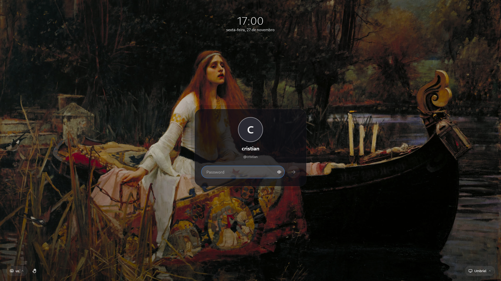

# Love — tema para SDDM

Tema simples e limpo para o SDDM, inspirado no GDM.



## Recursos

- Avatar e nome do usuário, com troca de usuário clicando no avatar/nome.
- Campo de senha com botão de olho para mostrar/ocultar a senha.
- Teclado virtual embutido (não depende do Qt Virtual Keyboard), útil quando
  o teclado físico não está disponível.
- Indicador de Num Lock ativo.
- Botão de sessão (escolha do display manager/desktop: GNOME, KDE Plasma, etc.).
- Seletor de layout de teclado (quando o SDDM expõe os layouts).
- Aviso de Caps Lock ativado.
- Relógio e data no topo.
- Menu de energia (desligar, reiniciar, suspender, hibernar).
- Fundo, cor de destaque e fonte configuráveis.
- Funciona com o greeter Qt6 do SDDM 0.21+.

## Instalação

Requisitos: SDDM 0.21 ou mais recente com o greeter Qt6 (`sddm-greeter-qt6`)
e o módulo `qt6-qtsvg` (usado pelos ícones e pelo wallpaper em SVG).

```bash
./install.sh
```

O script copia o tema para `/usr/share/sddm/themes/love` e cria
`/etc/sddm.conf.d/zz-love.conf` com `Current=love`.

Para testar sem sair da sessão:

```bash
./test.sh
```

Ou diretamente:

```bash
sddm-greeter-qt6 --test-mode --theme /usr/share/sddm/themes/love
```

Para remover:

```bash
./uninstall.sh
```

## Configuração

As opções ficam em `theme.conf`:

```ini
[General]
background=assets/background.jpg
type=image
color=#101014
accent=#3584e4
font=Cantarell
locale=pt_BR
dateFormat="dddd, d 'de' MMMM"
```

- `background`: caminho absoluto ou relativo ao diretório do tema.
- `color`: cor de fundo usada enquanto a imagem carrega.
- `accent`: cor de destaque (foco do campo, botão de entrar).
- `font`: família de fonte usada na interface.
- `locale`: idioma da data no relógio (ex.: `pt_BR`, `en_US`). Vazio usa o
  locale do sistema.
- `dateFormat`: formato da data. Valores com vírgula precisam ficar entre
  aspas duplas, como no exemplo acima.

O tema já vem com o wallpaper `assets/background.jpg` (A Dama de Shalott,
de John William Waterhouse). O SVG original continua disponível como
alternativa: basta trocar para `background=assets/background.svg`.

Você também pode sobrescrever qualquer opção sem editar o arquivo do tema,
criando `theme.conf.user` no diretório do tema (o SDDM lê esse arquivo por
cima do `theme.conf`).

### Usando seu próprio wallpaper

```bash
sudo tee /usr/share/sddm/themes/love/theme.conf.user >/dev/null <<'EOF'
[General]
background=/caminho/para/seu/wallpaper.jpg
EOF
```

## Observações

- **Testado em:** Fedora 45, SDDM 0.21 e Qt 6.11.
- **Layout de teclado:** o SDDM 0.21 só expõe a lista de layouts no greeter
  X11. Em Wayland a lista fica vazia, então o botão de teclado é escondido
  automaticamente.
- **Teclado virtual:** é desenhado em QML pelo próprio tema e escreve direto
  no campo em foco; não precisa instalar `qt6-qtvirtualkeyboard`. Abra pelo
  ícone de toque no canto inferior esquerdo (ou feche com `Esc`).
- **Num Lock:** o indicador "Num" aparece na barra inferior apenas quando o
  Num Lock está ativo.
- **Sessão:** o botão de sessão lista os arquivos `.desktop` encontrados em
  `/usr/share/wayland-sessions` e `/usr/share/xsessions`.
- **Avatar:** usa o ícone do usuário configurado no SDDM/AccountsService.
  Sem avatar, o tema mostra a inicial do nome.
- **Tela de bloqueio:** este é um tema de login do SDDM; ele não substitui a
  tela de bloqueio da sua sessão.

## Estrutura

```
Main.qml              interface principal
theme.conf            configuração visual
metadata.desktop      metadados do tema
components/           componentes reutilizáveis (avatar, campo, menus...)
assets/               ícones SVG e wallpapers
install.sh            instalação
uninstall.sh          remoção
test.sh               teste local com o greeter
```

## Licença

MIT. Veja `LICENSE`.
